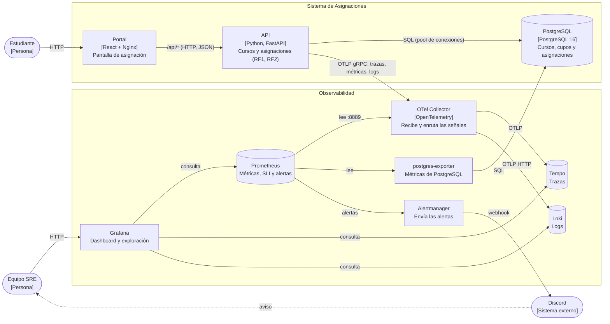

# Diagrama C4 · Contenedores (nivel 2)

Lo que quedó construido en el prototipo, tal como lo levanta `docker-compose.yml`.

| Contenedor | Tecnología | Responsabilidad |
|---|---|---|
| Portal | React servido por Nginx | Pantalla del estudiante. Reenvía `/api/*` a la API |
| API | Python, FastAPI | `GET /cursos`, `POST /asignaciones`, `/salud` y `/admin/*`. Emite trazas, métricas y logs |
| PostgreSQL | PostgreSQL 16 | Cursos, cupos y asignaciones, con `CHECK (cupos >= 0)` y `UNIQUE (estudiante_id, curso_id)` |
| OTel Collector | OpenTelemetry Collector | Recibe OTLP de la API y lo envía a Tempo, Loki y Prometheus |
| Tempo | Grafana Tempo | Guarda las trazas |
| Loki | Grafana Loki | Guarda los logs, con el `trace_id` de cada uno |
| Prometheus | Prometheus | Lee las métricas, calcula el SLI y evalúa las 4 alertas |
| postgres-exporter | Prometheus community | Métricas de PostgreSQL para Prometheus |
| Alertmanager | Prometheus Alertmanager | Agrupa las alertas y las manda a Discord |
| Grafana | Grafana | Dashboard *Asignaciones · SRE* y saltos entre trazas y logs |
